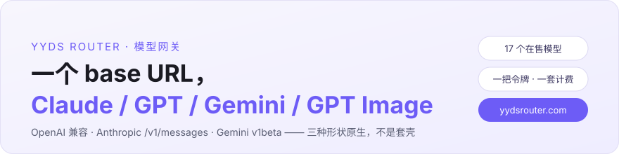

# YYDS Router · 一个地址接入 Claude / GPT / Gemini / GPT Image（OpenAI、Anthropic、Gemini 三种协议原生）

<p align="center">
  
</p>

<p align="center">
  <a href="https://github.com/shawnshi11/yydsrouter/stargazers"></a>
  &nbsp;
  <a href="./LICENSE"></a>
  &nbsp;
  <a href="https://yydsrouter.com/"></a>
</p>

> **如果这份资料对你有用，点右上角的 ⭐ Star 一下。** 它不会改变任何接口行为，
> 只影响这份文档下次更新的速度 —— 也是别人判断"这东西还有人在维护"的唯一信号。

**直接找**：[支持的模型](#支持的模型) ｜ [五分钟上手](#五分钟上手) ｜ [三种协议](#三种协议一次说清) ｜ [客户端接入](#客户端接入) ｜ [计费规则](#计费规则) ｜ [错误码](#错误码) ｜ [常见叫法](#常见叫法你可能这样搜) ｜ [FAQ](#常见问题faq)

> **线上入口**（模型广场、价格、控制台都在这里）：<https://yydsrouter.com/>
>
> **接入文档**（10 篇，逐篇成页）：<https://yydsrouter.com/guide/>
>
> **模型速查**：[Gemini 4 系列怎么选](https://yydsrouter.com/guide/models/gemini-4/) ·
> [Claude 5 系列怎么选](https://yydsrouter.com/guide/models/claude-5/) ·
> [GPT 6 系列怎么选](https://yydsrouter.com/guide/models/gpt-6/)

这个仓库是这个网关的**公开接入资料**：模型清单、价格口径、三种协议的示例代码、客户端配置、错误码与常见坑。

> 长文档（接入步骤、模型选型、SKILL 用法）在文档站 <https://yydsrouter.com/guide/>，本仓 `docs/` 只是索引；
> 示例代码与客户端配置以本仓为准。

**一句话**：把 Claude、GPT、Gemini、GPT Image 收敛成 **一个域名 + 一把令牌 + 一套计费**；
你只改客户端里的 `base_url`，不换 SDK、不改代码形状。

---

## 先说清楚：这是什么、不是什么

| 这是 | 这不是 |
| --- | --- |
| 一个**协议转换 + 计量**的网关：上游是 Anthropic / OpenAI / Google 的官方接口 | **不是**模型本身，不训练、不微调、不改输出 |
| 三种**原生**请求形状：OpenAI 兼容、Anthropic `/v1/messages`、Gemini `v1beta` | **不是**"把一切都套成 OpenAI 形状"的壳——Anthropic 客户端走 `/v1/messages`，不需要 Anthropic→OpenAI 的中间层 |
| 按量计费：输入 / 输出 / 缓存分价，图像按分辨率 × 画质按张 | **不是**包月套餐或点数卡；也没有"无限量"档 |
| 每笔调用逐条可查：模型、令牌、token 数、扣费 | **不是**黑盒：失败请求不扣费，日志里记 `quota=0` |

## 适合谁

| | |
| --- | --- |
| ✅ 适合 | 你在用 Claude Code、Codex、ChatGPT 类客户端、Cherry Studio、OpenAI SDK，只想**换一个 base URL** 就能调多家模型 |
| ✅ 适合 | 你要**同一把令牌**串起 Claude + GPT + Gemini，而不是每家用一套 key、一套账单 |
| ✅ 适合 | 你需要 OpenAI / Anthropic / Gemini **三种形状**都通（比如同一套代码跑 Anthropic SDK 和 Gemini SDK） |
| ✅ 适合 | 你要生成图片（GPT Image 2.5 / 2.6，1K–4K）但不想为它单独接一个云厂商 |

## 支持的模型

**17 个在售模型**：Claude 5 款、GPT 6 系 3 款、Gemini 5 款、GPT Image 4 款。

| 模型 | 上下文 | 最大输出 | 一句话 |
| --- | --- | --- | --- |
| `claude-haiku-5.5` | 1M | 128K | 最便宜最快：分类、抽取、路由、子任务 |
| `claude-sonnet-5.5` | 1M | 128K | **日常主力**：写代码、修 bug、文档表格 |
| `claude-opus-5.5` | 1M | 128K | 最强推理：长文、复杂重构、难 bug |
| `claude-opus-5.5-fast` | 1M | 128K | 同 Opus 的脑子，双倍价换更快响应 |
| `claude-fable-5.2` | 1M | 128K | agentic 编码与长任务旗舰，思考强制开启 |
| `gpt-6-luna` | 1.05M | 128K | GPT 6 系最快最省 |
| `gpt-6.2-sol` | 1.05M | 128K | 6.2 代主力：编码、写作、通用推理 |
| `gpt-6.2-astra` | 1.05M | 128K | 6.2 代最强档 |
| `gemini-3.8-flash` | 1M | 64K | 更便宜的上代：够用就选它 |
| `gemini-4-hydrogen` | 1M | 64K | Gemini 4 里最快最省 |
| `gemini-4-argon` | 1M | 64K | 高效推理档：同价里更省思考 token |
| `gemini-4-carbon` | 1M | 64K | 最强推理：深数学、科研、长链路 agent |
| `gemini-4-neon` | 1M | 64K | 最新一代前沿智能 |

**图像模型**：`gpt-image-2.5-flare` / `gpt-image-2.5-sunburst` / `gpt-image-2.6-flare` / `gpt-image-2.6-sunburst`。
支持 **1K / 2K / 4K** 三档分辨率与 **low / medium / high** 三档画质，可传 `aspect_ratio`，一次最多 4 张：

- **`flare`** 偏艺术表现力（插画、概念原画、海报），**`sunburst`** 偏写实（产品图、人像、带文字的排版）。

> **价格不写在这里**（上游调价会让文档过期）：实时价格与上下文/输出上限见
> [模型广场](https://yydsrouter.com/pricing)，每个模型点进去就是「定价」页。

## 五分钟上手

1. 打开 <https://yydsrouter.com/sign-in> 登录 → 控制台「API 密钥」**建一把令牌**（可限额度、限模型、设有效期）。
2. 把客户端的 base URL 换成 `https://yydsrouter.com/v1`，密钥填令牌。
3. 直接发请求：

```bash
curl https://yydsrouter.com/v1/chat/completions \
  -H "Authorization: Bearer $TOKEN" \
  -H "Content-Type: application/json" \
  -d '{"model":"claude-haiku-5.5","max_tokens":64,
       "messages":[{"role":"user","content":"只回两个字：收到"}]}'
```

Python / Node / 三种协议的完整示例见 [`examples/`](./examples/)，都是可直接抄的参考实现。

## 三种协议，一次说清

| 你的客户端说 | 打哪个路径 | 说明 |
| --- | --- | --- |
| OpenAI 兼容 | `POST /v1/chat/completions`、`/v1/models` | 绝大多数 SDK 与桌面客户端 |
| OpenAI Responses | `POST /v1/responses` | Codex CLI、新版 OpenAI SDK |
| Anthropic | `POST /v1/messages` | **Claude Code**、Anthropic SDK（无需中间层） |
| Gemini | `POST /v1beta/models/{model}:generateContent` | Google SDK |
| 图像 | `POST /v1/images/generations` | GPT Image 系列，支持 `resolution` / `quality` / `aspect_ratio` / `n` |

三种形状**都指向同一批模型、同一套计费**：你用 Anthropic 形状调 `claude-haiku-5.5`，和用 OpenAI 形状调它，账单口径一致。

## 客户端接入

| 客户端 | 怎么填 | 细节 |
| --- | --- | --- |
| **Claude Code** | `ANTHROPIC_BASE_URL=https://yydsrouter.com` + `ANTHROPIC_AUTH_TOKEN=<令牌>`，模型填 `claude-haiku-5.5` 之类 | [examples/claude-code.md](./examples/claude-code.md) |
| **Codex CLI** | `base_url = "https://yydsrouter.com/v1"`、`env_key` 指令牌、`wire_api = "responses"` | [examples/codex.md](./examples/codex.md) |
| **Cherry Studio** | 添加 OpenAI 兼容服务商 → 地址 `https://yydsrouter.com/v1` → 模型用途改「图像生成」即可生图 | [examples/cherry-studio.md](./examples/cherry-studio.md) |
| **OpenAI SDK / LangChain / Cursor** | 只改 `base_url` + `api_key` | [examples/python.py](./examples/python.py) |
| **curl / 任何 HTTP 客户端** | 见上方 curl | [examples/curl.sh](./examples/curl.sh) |

## 计费规则

1. **缓存命中更便宜**：同一段系统提示或长文档反复用时，缓存读按输入价的一小部分计（各模型折扣不同）。
2. **失败不扣费**：上游报错、参数非法、超过输出上限这类请求，日志里记 `quota=0`。

图像的三个细节：`n` 最多 4 张（按张收费）；不传 `quality` 时按**最低档**计价（宁可少收）；
分辨率按档位计价（1K / 2K / 4K），具体档位以模型广场为准。

## 错误码

| HTTP | 响应里的 `type` / `code` | 含义 / 怎么办 |
| --- | --- | --- |
| 401 | `yydsai_error` | 令牌无效或已删除 → 核对 `Authorization: Bearer sk-...` |
| 403 | `yydsai_error` | 额度不足，或模型不在该令牌分组 → 控制台看额度/分组 |
| 400 | `yydsai_error` | 参数不合法；`max_tokens` 超过模型输出上限时是中文提示，**不打上游、不扣费** |
| 429 | — | 触发限流（每人每分钟次数），等一会儿再试 |
| 503 | `yydsai_error` | 该模型暂时不可用（上游维护中）→ 稍后重试，或换同族模型 |

错误响应统一是 `{"error": {"message": "...", "type": "yydsai_error"}}`，客户端按 `type` 匹配即可。

## 常见叫法（你可能这样搜）

| 你可能用的词 | 在这里对应什么 |
| --- | --- |
| AI 网关 / LLM 网关 / 模型网关 | 就是本仓这个服务：把多家模型收敛到一个 base URL |
| API 中转 / API 代理 / 中转站 | 同一个东西；协议在网关侧转换，不是套壳 |
| Claude API / Claude 代理 / Claude Code 接入 | Anthropic `/v1/messages` 原生支持，Claude Code 直接填 base URL |
| GPT API / Codex 接入 | OpenAI `/v1/chat/completions` 与 `/v1/responses` 都通 |
| Gemini API / google 模型 | Gemini `v1beta` 形状 + 100 万上下文 |
| 多模型聚合 / 统一接口 / 一个 key 调所有模型 | 一把令牌 + 一套计费，见[支持的模型](#支持的模型) |
| 图片生成 API / GPT Image / 文生图 | 4 个 GPT Image 模型，按分辨率 × 画质按张计 |
| new-api / one-api 客户端 | 任何"能改 base URL"的 OpenAI 兼容客户端都能接 |

## 常见问题（FAQ）

**Q：为什么不直接用各家官方 API？**
A：如果你只用一个厂商、且能直连，官方最省事。这里的价值是：一个地址、一把令牌、一份账单，且三种协议都通。

**Q：会不会偷看/保存我的对话？**
A：不保存对话正文做训练或分析。用量日志只记模型、令牌、token 数与扣费。

**Q：某个模型暂时不可用怎么办？**
A：每个模型只挂一条官方渠道——这样同一个模型只有一个价格口径，账单不会因为路由到别家而变。
上游偶有波动时该模型会短暂不可用，换同族的另一个模型，或稍后重试即可。

## 免责与归属

- Claude / Anthropic、GPT / OpenAI、Gemini / Google 是各自公司的商标；本服务只是这些官方接口的接入与计量层。
- 模型输出由上游模型决定；请自行确认你的使用场景符合各家模型的服务条款与所在地区法规。
- 模型清单与价格随上游变化，**以 [模型广场](https://yydsrouter.com/pricing) 为准**。

## License

- 文档（`docs/`、`README.md`、`llms.txt`）：[CC BY 4.0](./LICENSE)
- 示例代码（`examples/`、`skill/`）：[MIT](./LICENSE-CODE)
